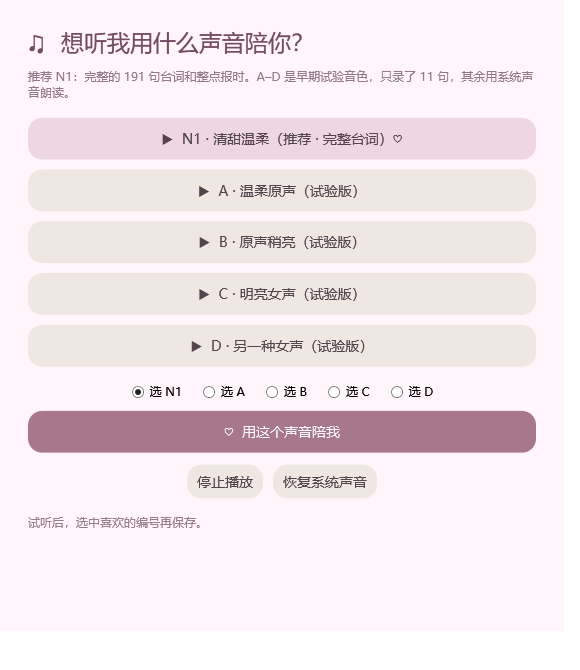

# Wanwan · Bedtime Companion

**A Windows desktop companion that turns “one more task” into a gentler end to the day.**

[](#quick-start)
[](#engineering)
[](docs/AI_ENGINEERING.md)
[](https://github.com/9OwO6/wanwan-shutdown-assistant/actions/workflows/verify.yml)


Wanwan (晚晚, “evening”) combines a warm companion personality, animated character art, an original AI-designed Mandarin voice, and a deterministic bedtime schedule. She appears on your desktop, reminds you to wrap up, leaves time to save your work, and can request a **normal Windows shutdown** after a final goodnight.

This is a personal **AI-assisted product engineering portfolio project**: native desktop interaction, generative media pipelines, OS integration, and testable behavior in one runnable application. The interface and voice are currently **Simplified Chinese**; this README and the engineering walkthrough are in English.

**[Download the portable preview](https://github.com/9OwO6/wanwan-shutdown-assistant/releases/latest)** · [Engineering case study](docs/AI_ENGINEERING.md) · [Architecture](docs/ARCHITECTURE.md) · [中文说明](docs/README.zh-CN.md)

## See it in action


*Runtime capture of the desktop reminder, using a muted, isolated demo scenario. These are rendered application surfaces, not design mockups.*

| Desktop companion | Time-aware reminder | Save-before-shutdown demo |
|:--:|:--:|:--:|
|  |  |  |

<details>
<summary>Explore the interaction gallery and voice selector</summary>




</details>

## What it does

- **Companion-style reminders.** Warm, affectionate Mandarin dialogue, with four variations per scene rather than a single repeated notification.
- **A desktop pet you can actually control.** Drag the avatar, persist its position, open the main window, hide it, or restore it from the tray. Hiding the pet leaves an enabled schedule running.
- **A staged bedtime flow.** Reminders 30 and 10 minutes before bedtime, a wrap-up window at bedtime, a final countdown, and a goodnight before the shutdown request. Overnight schedules are handled explicitly.
- **Acknowledge and keep working.** “Okay, I'll finish up and go to bed” shrinks the reminder into an animated Wanwan + countdown widget. Hide or expand it without deferring or cancelling the schedule; restore it from the tray. The final announcement brings a hidden countdown back into view.
- **Offline AI voice playback.** The selected N1 voice has **92 companion lines, 96 hour/phase reminders, and 3 guard-status lines**. The application plays prepared audio without loading a model or calling a cloud API.
- **Ten animated interactions.** Forty reviewed PNG poses derived from ten transparent sprite atlases, with frame timing, short transitions, and a reduced-motion option.
- **Video-ready transparent frames.** Forty reviewed 640×640 PNGs in [`assets/frames/`](assets/frames/), with neighboring-sleeve artifacts removed and shared placement. The application uses these same exports. [See the crop audit and before/after comparison](docs/FRAME_REPAIR.md).
- **Explicit controls.** Automatic shutdown starts disabled. “Save & enable shutdown” persists the schedule and the desktop avatar displays its current guard status. One wrap-up deferral and an emergency cancellation are available.
- **Windows-native behavior.** WPF windows, a system tray icon, optional per-user startup, single-instance activation, and a normal shutdown request through a small C# Win32 interop layer.

## Quick start

**Requirements:** Windows with Windows PowerShell 5.1 and its built-in WPF/.NET Framework components. No Node.js, Python, .NET SDK, GPU, API key, or AI model is needed to run the application. Windows 11 was the local development environment; broader OS compatibility has not been certified.

1. Download the portable preview and extract the ZIP, or clone this repository.
2. Launch from the extracted/cloned directory:

   ```powershell
   powershell.exe -NoProfile -ExecutionPolicy Bypass -File .\Start-Wanwan.ps1
   ```

   Alternatively, double-click **`启动晚晚.vbs`**. The launcher opens a native window without keeping a console visible.

3. Try **`体验睡前倒计时`** (“Try bedtime countdown”). This is a **35-second demonstration that never shuts down the computer**.
4. For real use, set **`睡觉时间`** (bedtime) and **`收尾分钟`** (2–30 minutes to wrap up). Click **`保存并开启关机`** (“Save & enable shutdown”) only when you want actual scheduled shutdown.

### A few useful translations

| UI label | Meaning |
|---|---|
| 温柔语音 / 减少动态 | Voice / reduced motion |
| 开机陪伴 / 桌面陪伴 | Start at Windows sign-in / keep the desktop avatar visible |
| 自动关机未开启 / 自动关机已开启 | Shutdown guard is off / on |
| 隐藏桌宠（守护继续） | Hide the pet; leave the guard running |
| 紧急取消今晚关机 | Cancel tonight's scheduled shutdown |

**Shutdown behavior:** the app requests normal Windows shutdown without force-killing applications. Unsaved-work dialogs may block shutdown; Wanwan cannot save documents for other applications. If launched after the deadline within the night's four-hour overdue window, it first gives two minutes to save. The final voice announcement finishes before the request. Requests can be retried after three minutes if the session remains active.

Settings and event logs stay in `%LOCALAPPDATA%\WanwanShutdown`. Runtime operation is local; prepared AI media is bundled. Closing the main window hides it; choosing **Exit** in the tray stops the assistant. Launching it again restores the existing instance.

## Engineering

### A quieter countdown


*Actual WPF capture in the non-shutdown demo. Acknowledging, compacting, hiding and restoring all preserve the existing deadline.*

The interesting part is the integration: a friendly interface still needs correct scheduling, clear state, dependable background lifetime, and careful OS behavior.

| Area | Implementation | What it demonstrates |
|---|---|---|
| Desktop runtime | PowerShell 5.1 + WPF/XAML | Shipping a native prototype with built-in Windows components |
| Scheduling | Pure `Get-NightState` function + Dispatcher timer | Explicit phases, midnight boundaries, overdue handling |
| Character interaction | Shared sprite surfaces and frame sequencing | Coordinated animation across main UI, pet, gallery and countdown |
| Audio | Prepared PCM assets, transcript routing, WPF playback | Consistent text/audio pairing without live inference |
| Windows integration | C# P/Invoke, mutex, named event, tray | Token privileges, normal shutdown, reliable single-instance reopening |
| Validation | Schedule tests, isolated WPF tests, asset manifests, CI | Separating visible behavior from a successful build or generated output |

### What AI contributed—and what engineering had to establish

Codex assisted with planning, implementation, debugging, test design and documentation. Generative tools supplied character artwork and the N1 synthetic voice. The project then treated those outputs as software inputs: catalogs, hashes, transcript checks, audio decoding, pose validation and real WPF playback tests.

Two practical bugs became useful engineering lessons:

1. **Hiding a modal main window ended the background lifetime.** The normal runtime now uses `Application.Run` with explicit shutdown, and a lifecycle test checks hide → background ticks → restore.
2. **A running avatar looked like an active shutdown guard.** The UI now exposes the real guard status, has a dedicated save-and-enable action, and tests that activation persists before an overdue reminder appears.

The case study also covers the Win32 privilege structure correction and the “voice first, shutdown request second” sequence. See [AI-assisted engineering](docs/AI_ENGINEERING.md).

## Verification

The GitHub workflow runs **headless schedule and asset-integrity checks**. Interactive behavior is verified locally on Windows through isolated WPF test modes:

```powershell
powershell.exe -NoProfile -ExecutionPolicy Bypass -File tests\Schedule.Tests.ps1
powershell.exe -NoProfile -STA -ExecutionPolicy Bypass -File app\Main.ps1 -GuardTest
powershell.exe -NoProfile -STA -ExecutionPolicy Bypass -File app\Main.ps1 -PetControlsTest
powershell.exe -NoProfile -STA -ExecutionPolicy Bypass -File app\Main.ps1 -PetTest
powershell.exe -NoProfile -STA -ExecutionPolicy Bypass -File app\Main.ps1 -DialogueTest
powershell.exe -NoProfile -STA -ExecutionPolicy Bypass -File app\Main.ps1 -LifecycleTest
powershell.exe -NoProfile -STA -ExecutionPolicy Bypass -File app\Main.ps1 -CountdownTest
python tools\verify_release_assets.py
```

Local checks cover **11 schedule boundaries**, overdue countdown and announcement ordering, cancellation, retry timing, persisted activation, pet controls, four scheduled reminder phases, and native muted audio opening. Test modes use isolated writes and substitute simulated shutdown requests; they do not call the native shutdown operation. `GuardTest` does exercise privilege acquisition in its own process.

**Evidence boundary:** configuration persistence, countdown visibility, simulated shutdown sequencing and native media playback have been verified. The published test suite does **not** prove a completed OS shutdown or every third-party application's unsaved-work behavior. See [verification notes](docs/VERIFICATION.md).

## Source map

```text
app/                  Native UI, schedule, voice, pet, interop and WPF tests
assets/               Runtime artwork, icons, audio catalogs and manifests
tests/                Deterministic schedule tests
tools/                Media generation, composition, inspection and verification
docs/                 English case study, architecture, screenshots and Chinese guide
.github/workflows/    Windows schedule checks and portable asset verification
Start-Wanwan.ps1      Portable English-named launcher
```

Python media-production scripts are **optional development tools** and need their own model/audio environment. Historical audition scripts retain local-environment assumptions; they are not runtime dependencies. [Media provenance and licensing](docs/ASSETS.md) explains the distinction between application code, bundled media and external tools.

## Project status

Personal Windows prototype with a working companion flow. It is not a signed installer or a production service. English UI localization, weekend-specific schedules, accessibility expansion and broader Windows compatibility checks are future work.

Application code is MIT licensed; bundled artwork/audio and third-party components have separate terms in [NOTICE](NOTICE.md). Created by [9OwO6](https://github.com/9OwO6) with AI-assisted development.
