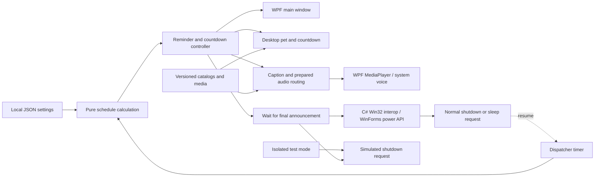

# Architecture

The native and simulated shutdown paths are selected by the test-mode guard. The diagram depicts both available paths, not two simultaneous requests.

## Modules

| Module | Responsibility |
|---|---|
| `Main.ps1` | Window construction, settings, tray, single instance, Dispatcher and shutdown sequence |
| `Schedule.ps1` | Given a clock value and settings, determine each night's bedtime (weekday or Fri/Sat weekend), deadline and phase |
| `DesktopPet.ps1` | Compact/expanded presentation, dragging, persisted position, hide/open controls and hour reminders |
| `Visuals.ps1` | Shared character surfaces, sprite frames, transitions and reduced motion |
| `Dialogue.ps1` | Scene catalogs, non-repeating line selection and system-voice addressing |
| `Voice.ps1` / `GuardVoice.ps1` | Exact caption/asset routing and audio duration |
| `Icons.ps1` | Window/tray branding and work-area placement |
| `History.ps1` | Per-night results, inference from the last time the computer was seen awake, streak and last-seven-nights marks (pure functions) |
| `Watch.ps1` | Sleep watch (caught countdown), streak display and morning greeting, background update check/download and installer hand-off |
| `UpdateCore.ps1` / `ApplyUpdate.ps1` | Version comparison and asset selection; detached installer that waits for exit, copies files and relaunches |
| `Power.ps1` | Token privilege handling and non-forced shutdown API (sleep uses `Application.SetSuspendState`) |

## State and lifetime

The normal app owns an explicit WPF `Application` lifetime. Hiding a window does not terminate its message loop. A named mutex enforces one runtime instance; a named event lets a second launch restore the existing main window. Quitting through the tray ends the application and releases its resources.

Settings and cancellation/deferral markers persist locally. Test modes write into `output/` instead of the user configuration. The showcase uses a synthetic default schedule and muted audio. Neither local logs nor the user's settings are committed to this repository.

## Schedule phases

`Day → Early → Soon → Bed → Final → Due`

Early starts 30 minutes before bedtime, Soon at 10 minutes, Bed at bedtime and Final two minutes before the deadline. Due begins at the deadline. The current nightly window ends four hours after that deadline; later use is associated with a future night rather than forcing a daytime shutdown.

Each night's bedtime is computed from the evening it belongs to: a bedtime earlier than noon (such as 01:00) falls on the following calendar day, so Friday night's 01:00 is Saturday morning. Friday and Saturday evenings use `WeekendBedtime` when it is set. The cancellation/deferral key remains the bedtime's calendar date, so settings written by earlier versions keep working.

Sleep keeps the process alive, so the controller handles a resume explicitly: a gap of more than a minute in real (not scheduled) time while a countdown is open grants a fresh two-minute save window, and a countdown left open after the night window ends is closed.

The controller decides whether to show a bubble, a save window or a final announcement. Presentation visibility is independent of an enabled guard: a hidden desktop pet can still receive a scheduled reminder.

## Runtime vs. asset production

Runtime uses bundled artwork and 64 kbps MP3 audio encoded from WAV masters (`tools/encode_runtime_audio.py`); the masters, references and composition fragments stay in the repository but are not shipped. Model weights, GPU libraries and media-generation services are not bundled or loaded by the application. Python generation tools are development utilities; their outputs are validated before runtime playback.
